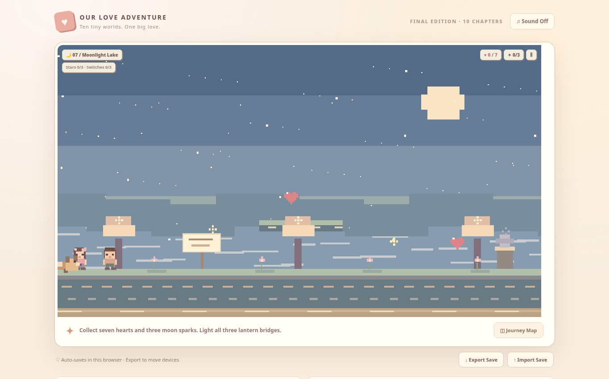

# Our Love Adventure — Final Edition ❤️

A complete 10-chapter, English-language, cozy pixel platformer. Made with plain HTML, CSS, JavaScript and Canvas. **No dependencies, builds, accounts, or external assets.**

## Quick play

Open `index.html` in a modern browser, or open `Our_Love_Adventure_Final.html` for a single-file version.

## Publish on GitHub Pages

1. Create a new public GitHub repository (for example `our-love-adventure`).
2. Upload **the contents of this folder** to the root of the repository (`index.html`, the `assets` folder, `README.md` and `.nojekyll`). Do not upload the ZIP as the website itself.
3. Commit your changes.
4. In your repo go to **Settings → Pages → Build and deployment**.
5. Under **Source**, select **Deploy from a branch**. Set branch to `main` and folder to `/(root)`. Save.
6. After GitHub Pages builds the site, your public URL normally looks like `https://YOUR-USERNAME.github.io/our-love-adventure/`. Use the actual URL shown in **Settings → Pages**.

The website is static; it needs no server or API keys. Everything runs entirely in the visitor’s browser.

## Controls

| Action | Keyboard | Phone |
|---|---|---|
| Move | A / D or ← / → | Left / right on-screen |
| Jump | Space, W, or ↑ | JUMP |
| Interact / advance dialogue | E | ♥ / Next |
| Pause | Escape | Ⅱ button |

Follow the objective shown at the top left. Collect hearts, activate switches, and press E by the gate to finish each chapter. Some puzzles need your companion or Pudding nearby; wait a moment for them to catch up.

## Chapters

1. First Bloom Garden
2. Heartfelt Town
3. Promise in the Rain
4. Starlit Forest
5. Bridge of Clouds
6. Our Cozy Home (furniture and matching outfits)
7. Moonlight Lake
8. Sweetheart Carnival
9. Lighthouse Promise
10. The Forever Garden (final ending)

## Save and privacy

Progress is automatically saved to **this browser's local storage**, which is local to each site origin and browser. It **does not sync** between users or devices. The game includes **Export Save** and **Import Save** buttons to manually transfer progress via a JSON file. Export your save **before switching between the downloaded HTML file and GitHub Pages**, or switching browsers/devices. Starting a New Adventure resets the current save (after confirmation). Imported saves replace progress on that browser only after confirmation.

The game will attempt to import V1, V2 and V3 local progress if older saves are visible on the same browser origin; this usually will not work across a `file://` page and a GitHub Pages site, so use Export/Import on the Final Edition as the reliable method.

**Everything is offline-capable:** There are no trackers, analytics, ads, remote requests, or external libraries. Sound is off by default.

## Files

- `index.html` — website entry point for GitHub Pages
- `assets/styles.css` — responsive UI styles
- `assets/game.js` — story, physics, puzzles, characters, save state, pixel art canvas drawing
- `assets/heart.svg` — game icon
- `Our_Love_Adventure_Final.html` — all-in-one game, useful for direct sharing
- `.nojekyll` — tells GitHub Pages to serve static files as-is

## Notes

This is a **single-player** adventure with an AI-following companion and a puppy. Two people on separate phones do **not** play in the same shared world, and progress is not synced. Gamepad is not included.

## Tested in the Final Edition

Automated browser testing covered all ten level-clear paths, hearts / keys / star collectibles, all puzzle switches, hidden letters, the furniture and wardrobe interfaces, final dialogue, save export-import, mobile on-screen movement, desktop keyboard movement and V3 save-data migration logic. A separate check confirmed the bridge collision geometry and that all linked website assets exist. Actual layout and gameplay should still be checked once on your published GitHub Pages URL, especially on your girlfriend’s phone.

## Main menu update

The former V3 shortcut (“Played V3? Begin Chapter 7”) has been removed from the main menu and JavaScript. New players begin at Chapter 1, while existing local saves can continue from their unlocked chapters. The Journey Map remains available.
